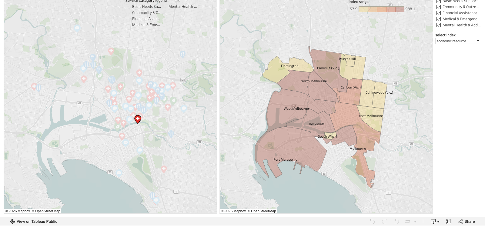
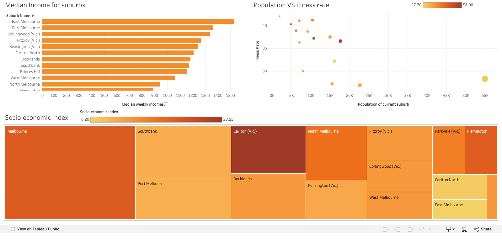
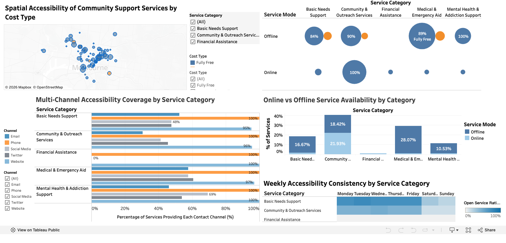
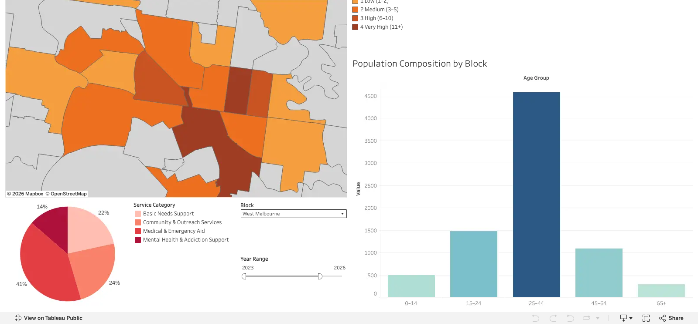

# Community Service Accessibility: Melbourne

A decision-support dashboard for urban planners. It shows how well free and low-cost community services (housing, health, food, crisis support and more) reach residents across inner-Melbourne suburbs.

The project combines **Tableau** maps and charts, published on Tableau Public, with an **R Shiny** app that brings the four dashboards together into one tabbed interface for stakeholder presentations.

University of Melbourne team project (team of four), Oct–Nov 2025.



## The problem

Free and cheap support services are only useful if the people who need them can find and reach them. Planners need to compare three things side by side:

- **where services are**, by category (basic needs, community and outreach, financial assistance, medical and emergency aid, mental health and addiction support);
- **who lives where**, using socio-economic disadvantage, income, unemployment, health, renting and age structure;
- **how accessible each service is**: cost, online or offline delivery, contact channels, opening hours and nearby public transport.

The dashboard puts these together by suburb, so gaps between service supply and resident need are visible at a glance.

## Dashboards

| Tab | What it shows | Tableau Public |
|---|---|---|
| 1. Map Distribution | Two linked maps: service locations by category, and a suburb choropleth of a selectable socio-economic index | [View](https://public.tableau.com/views/Book1map_17615369781360/Dashboard1) |
| 2. Suburb Resident Information | Median income, population vs illness rate, and a SEIFA treemap by suburb | [View](https://public.tableau.com/views/SuburbInformation/Dashboard1) |
| 3. Service Supply Accessibility | Cost type, online vs offline delivery, contact channels and weekly opening-hour coverage by service category | [View](https://public.tableau.com/views/Tab3-ServiceSupplyAccessibility/Tab3ServiceSupplyAccessibility) |
| 4. Community Profile | Service density by area against population age structure (2023–2026 forecasts) | [View](https://public.tableau.com/views/Melbourneservice/Dashboard1) |

<details>
<summary>Screenshots of tabs 2–4</summary>





</details>

## Data and GIS work

Six public datasets were integrated and joined on the ABS 2021 suburb (SAL) code:

| Dataset | Publisher | Used for | Licence |
|---|---|---|---|
| [ASGS Edition 3 digital boundary files](https://www.abs.gov.au/statistics/standards/australian-statistical-geography-standard-asgs-edition-3/jul2021-jun2026/access-and-downloads/digital-boundary-files): 2021 Suburbs and Localities (SAL) and Significant Urban Areas (SUA), GDA94 shapefiles | Australian Bureau of Statistics | Suburb polygons for the choropleth maps | CC BY 4.0 |
| [Socio-Economic Indexes for Areas (SEIFA) 2021](https://www.abs.gov.au/statistics/people/people-and-communities/socio-economic-indexes-areas-seifa-australia/2021) | Australian Bureau of Statistics | IRSD, IRSAD, IER and IEO indices and deciles by suburb | CC BY 4.0 |
| [2021 Census QuickStats](https://www.abs.gov.au/census/find-census-data/quickstats/2021) (suburb level) | Australian Bureau of Statistics | Population, unemployment, income, renting and long-term health indicators | CC BY 4.0 |
| [City of Melbourne population forecasts by small area](https://data.melbourne.vic.gov.au/explore/dataset/city-of-melbourne-population-forecasts-by-small-area-2020-2040/information/) (2020–2040 release) | City of Melbourne | Age and gender structure by area and year | CC BY 4.0 |
| Public transport stops (GeoJSON: stop ID, name and mode) | Department of Transport and Planning, Victoria, via [DataVic](https://discover.data.vic.gov.au/) | Train, tram and bus context for services | CC BY 4.0 |
| [Free and cheap support services, with opening hours, public transport and parking options](https://data.melbourne.vic.gov.au/explore/dataset/free-and-cheap-support-services-with-opening-hours-public-transport-and-parking-/information/) | City of Melbourne | Service locations, categories, cost, contact channels, hours, nearest transport | CC BY 4.0 |

Preparation, done in Excel:

- unified suburb names and SAL codes across sources (for example `Carlton` vs `Carlton (Vic.)`);
- handled missing values in service and census records;
- reshaped census and service records into tables that join on suburb code.

In Tableau:

- an **"all index"** calculated field that combines the socio-economic indicators, plus a parameter ("select index") to switch which index colours the suburb map;
- parameter-driven filters by service category;
- tooltips that show each service's nearest train station and its tram and bus routes.

The City of Melbourne has since replaced the 2020–2040 forecasts with a 2023–2043 release. The copy used in this project is kept in `data/raw/`.

## Repository layout

```
app/app.R                     R Shiny app: four tabs, one embedded Tableau Public dashboard each
tableau/                      Tableau workbook for tab 1 (Map Distribution)
data/raw/                     Public transport stops (GeoJSON) and population forecasts (CSV)
data/processed/               Cleaned, joinable tables used by the dashboards
data/scripts/                 Script to download the large ABS boundary files
docs/screenshots/             Dashboard screenshots
```

The workbooks for tabs 2–4 were built by teammates and are not included here. They can be viewed and downloaded from the Tableau Public links above.

## Running the Shiny app

Requirements: R (4.x), the `shiny` and `htmltools` packages, and an internet connection (the dashboards are loaded from Tableau Public).

```r
install.packages(c("shiny", "htmltools"))
shiny::runApp("app")
```

Or open `app/app.R` in RStudio and click **Run App**. The layout is designed for desktop screens at least 1200 px wide; each dashboard is resized to fit the window height.

## Getting the boundary files

The ABS shapefiles are too large for git (the SAL shapefile is about 140 MB). To download them into `data/raw/`:

```bash
bash data/scripts/download_boundaries.sh
```

They are only needed to rebuild the map workbook. The Shiny app does not use them.

## My contribution

This was a team project with four members. My part:

- sourced and integrated the public datasets above and joined them by suburb code;
- cleaned and standardised the data in Excel (suburb names and codes, missing values, reshaping census and service records into joinable tables);
- built the **Map Distribution** dashboard (tab 1): the interactive Tableau maps, the "all index" calculated field, parameter-driven filters, and the nearest train, tram and bus tooltips;
- built the **R Shiny app** that combines the team's four Tableau Public dashboards into one tabbed application for stakeholder presentations.

My teammates designed and built the Suburb Resident Information, Service Supply Accessibility and Community Profile dashboards (tabs 2–4).

## Credits and licences

- Thanks to my three teammates, who built tabs 2–4.
- Source data © Australian Bureau of Statistics, © City of Melbourne and © State of Victoria (Department of Transport and Planning), used under [Creative Commons Attribution 4.0](https://creativecommons.org/licenses/by/4.0/). The processed tables in `data/processed/` are derived from these sources and stay under the same licence.
- Base maps in the Tableau dashboards © Mapbox © OpenStreetMap contributors.
